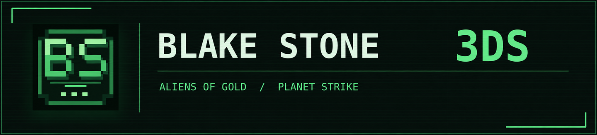

<div align="center">



**Blake Stone: Aliens of Gold and Planet Strike on New Nintendo 3DS.**

[](https://github.com/xXNukem/bstone-3ds/releases/latest)

[](LICENSE.txt)

</div>

---

<div align="center">

## ☕ Support the project

If you enjoy the port and want to buy me a coffee, you can do it here. Every bit helps with future updates and projects. No pressure, of course.

<a href="https://ko-fi.com/xxnukem"></a>

**[ko-fi.com/xxnukem](https://ko-fi.com/xxnukem)**

</div>

---

## What is Blake Stone 3DS?

Blake Stone 3DS is an unofficial homebrew port of **Blake Stone: Aliens of Gold** and **Blake Stone: Planet Strike**, based on [BStone](https://github.com/bibendovsky/bstone) by Boris I. Bendovsky.

Both games run from a single executable, with a game selector at startup. The port adapts the original gameplay to the 3DS's two screens, controls and stereoscopic display.

## Features

- **Both Blake Stone games** in one executable, including the shareware and full editions of *Aliens of Gold*.
- **Stereoscopic 3D**, adjusted with the console's 3D slider.
- **Full-screen gameplay** on the upper screen, with the original status information moved to the lower screen.
- **Lower-screen HUD and live automap**, showing health, ammo, weapons, score, access cards and an animated ECG monitor.
- **Redesigned menus and loading screens**, with green phosphor and CRT effects.
- **Three control layouts:** Classic, Modern and Modern + C-Stick.
- **Optional weapon bobbing**, widescreen or centered 4:3 presentation, and the original game audio.
- **Separate profiles** for the supported game editions.

## Download and installation

Download the latest [`bstone.3dsx`](https://github.com/xXNukem/bstone-3ds/releases/latest) release and place it on your SD card:

```text
sdmc:/3ds/bstone/
    bstone.3dsx
    games/
        aog/
        ps/
    profiles/
```

Put your original **Aliens of Gold** files in `games/aog/` and **Planet Strike** files in `games/ps/`. Launch the application through the Homebrew Launcher.

**You must provide your own original game files. They are not included with this port.** The free *Aliens of Gold* shareware edition is supported.

### Required game files

<details>
<summary><strong>Aliens of Gold — Shareware (.BS1)</strong></summary>

```text
AUDIOHED.BS1
AUDIOT.BS1
IANIM.BS1
MAPHEAD.BS1
MAPTEMP.BS1
SANIM.BS1
VGADICT.BS1
VGAGRAPH.BS1
VGAHEAD.BS1
VSWAP.BS1
```

</details>

<details>
<summary><strong>Aliens of Gold — Full version (.BS6)</strong></summary>

```text
AUDIOHED.BS6
AUDIOT.BS6
EANIM.BS6
GANIM.BS6
IANIM.BS6
MAPHEAD.BS6
MAPTEMP.BS6
SANIM.BS6
VGADICT.BS6
VGAGRAPH.BS6
VGAHEAD.BS6
VSWAP.BS6
```

</details>

<details>
<summary><strong>Planet Strike — Full version (.VSI)</strong></summary>

```text
AUDIOHED.VSI
AUDIOT.VSI
EANIM.VSI
IANIM.VSI
MAPHEAD.VSI
MAPTEMP.VSI
VGADICT.VSI
VGAGRAPH.VSI
VGAHEAD.VSI
VSWAP.VSI
```

</details>

Do not mix data from different editions or releases. The startup selector checks the installed files against known SHA-1 signatures and reports missing or unsupported data before launching the game.

### Game selector

| Button | Action |
|:--|:--|
| D-Pad / Circle Pad | Select game |
| Left / Right | Switch between available *Aliens of Gold* editions |
| A | Verify and launch |
| X | Rescan game files |
| B | Exit confirmation |

The selected game stays active until you close the application.

### Updating an existing installation

Replace `bstone.3dsx` with the newer release. Leave your original game data in place.

New saves and settings are kept in separate folders:

```text
sdmc:/3ds/bstone/profiles/aog_sw/
sdmc:/3ds/bstone/profiles/aog_full/
sdmc:/3ds/bstone/profiles/ps/
```

Older installations with *Aliens of Gold* data directly inside `sdmc:/3ds/bstone/` are still recognized through the legacy compatibility mechanism.

**Back up your saves before updating.**

## Controls

You can switch between three layouts in **Control Settings**. Press **BUTTON GUIDE** in the game to see the current layout.

### Classic

| Button | Action |
|:--|:--|
| Circle Pad / D-Pad ↑ ↓ | Move forward / backward |
| Circle Pad / D-Pad ← → | Turn |
| L / R | Strafe left / right |
| A | Fire |
| B | Interact / open doors |
| ZL / ZR | Next / previous weapon |
| X | Toggle automap |
| START | Game menu |
| START + SELECT | Exit to Homebrew Launcher |

### Modern

| Button | Action |
|:--|:--|
| Circle Pad ↑ ↓ | Move forward / backward |
| Circle Pad ← → | Strafe left / right |
| Y / A | Turn left / right |
| R | Fire |
| B | Interact / open doors |
| D-Pad ← → | Previous / next weapon |
| X | Toggle automap |
| START | Game menu |
| START + SELECT | Exit to Homebrew Launcher |

### Modern + C-Stick

Uses the **Modern** layout, with the **C-Stick** available for horizontal turning. Y and A still work for turning as well. There is no vertical freelook.

In menus, **A confirms** and **B goes back**. The selected control layout is saved in the game preferences.

## Screens and 3D

The upper screen is used for the first-person view. The original DOS status bar has moved to the lower screen, alongside a live automap and the animated health monitor.

The stereo renderer uses a separate viewpoint for each eye for walls, actors, objects and weapons. Depth is controlled using the console's physical 3D slider. The menus also have a subtler stereoscopic effect.

Video options include widescreen or centered 4:3 gameplay and a CRT effect for the menus. Audio retains the original BStone sound systems, including OPL emulation and game sound effects.

## Compatibility

**Tested and working on New Nintendo 3DS XL.**

Other models in the Nintendo 3DS family haven't been tested yet. You'll need a console capable of running homebrew through the Homebrew Launcher.

Known limitations:

- No touchscreen control layout.
- The C-Stick only controls horizontal turning.
- Modified or unsupported game-data sets may fail integrity checks.
- Not every historical version or original save file has been tested.
- Performance can vary between scenes, especially with stereoscopic 3D enabled.

Found a bug? [Open an issue](https://github.com/xXNukem/bstone-3ds/issues) and mention the game edition, what happened and whether 3D was enabled.

## Building from source

You'll need:

- devkitPro / devkitARM, with libctru, Citro2D and Citro3D.
- CMake 3.18 or newer.
- `3dsxtool` and `smdhtool`.
- A separately built **Nintendo 3DS static SDL2** installation providing `SDL2::SDL2-static`.

A desktop SDL2 installation won't work for this target.

```sh
export DEVKITPRO=/opt/devkitpro

cmake -S . -B build/3ds-release \
  -DCMAKE_TOOLCHAIN_FILE="$DEVKITPRO/cmake/3DS.cmake" \
  -DSDL2_DIR=/path/to/SDL2-install-3ds/lib/cmake/SDL2 \
  -DBSTONE_ENABLE_AI_WEAPONS=OFF \
  -DCMAKE_BUILD_TYPE=Release

cmake --build build/3ds-release --parallel 4
```

Output: `build/3ds-release/src/bstone/bstone.3dsx`.

Keep the generated ELF if you need to investigate ARM11 crashes. The [`docs/`](docs/), [`tests/`](tests/) and [`tools/`](tools/) folders contain further development material.

## Experimental artwork and AI use

There are experiments with alternative, AI-assisted weapon designs, textures and sprites. **These aren't part of the standard release.** The original game artwork remains the default.

AI tools were also used during development to inspect the BStone code, investigate bugs, assist with implementation, refactoring, testing and documentation. I made the design decisions, reviewed the work and tested the port on actual hardware.

## Credits

**Nintendo 3DS port:** Carlos de la Barrera Pérez ([xXNukem](https://github.com/xXNukem)).

**Original games and engine:**

- **JAM Productions** — *Aliens of Gold* and *Planet Strike*.
- **Apogee Software** — original publisher.
- **id Software** — Wolfenstein 3D engine heritage.
- **Boris I. Bendovsky and BStone contributors** — [BStone](https://github.com/bibendovsky/bstone).

**Tools and libraries:** devkitPro, libctru, Citro2D, Citro3D, SDL, DOSBox/DBOPL, Nuked OPL3, stb and their contributors.

This is an independent, unofficial homebrew project, not affiliated with Nintendo or the games' rights holders.

## License and game data

Source code retains the applicable BStone licenses and attributions, including **GPL-2.0-or-later** for the relevant code. Some bundled libraries and independently developed components have separate licenses.

See [LICENSE.txt](LICENSE.txt), [README_UPSTREAM.md](README_UPSTREAM.md), [SDL2's license](licenses/SDL2.txt) and the repository's other license notices.

**Original game assets are not included.** They remain the property of their respective rights holders.
